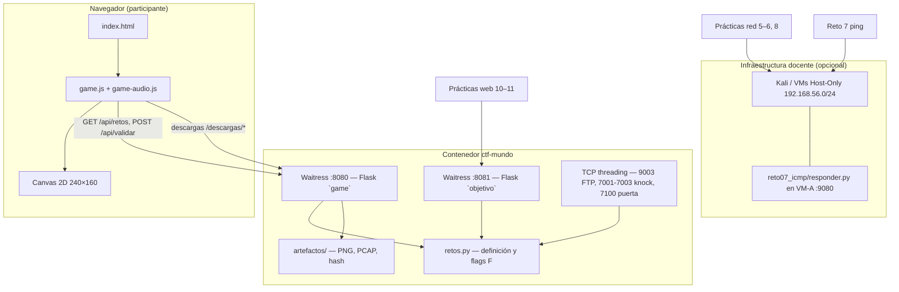

# Hackemon CTF — Especificaciones técnicas

Laboratorio gamificado de ciberseguridad: mapa 2D en el navegador, 12 retos (forense, OSINT, red y web) y validación centralizada de banderas. El despliegue principal es **un contenedor Docker** que publica servicios **solo en `127.0.0.1`**.

---

## Resumen de arquitectura

| Aspecto | Decisión |
|--------|----------|
| **Estilo** | Aplicación **monolítica** en un solo contenedor |
| **Patrón** | **Cliente–servidor**: frontend estático + API REST JSON |
| **Capas** | Presentación (HTML/CSS/JS + Canvas) · Aplicación (Flask/Waitress) · Servicios TCP auxiliares · Artefactos generados en build |
| **Estado del juego** | **Cliente** (`localStorage`); banderas y secretos **solo en servidor** |
| **Orquestación** | Docker Compose (un servicio `mundo`) |
| **Laboratorio híbrido** | Retos 5–7 usan VMs en red **Host-Only** fuera del contenedor (`reto07_icmp/`) |

### Diagrama de componentes



### Flujo de validación de banderas

1. El cliente carga retos sin campo `flag` (`PUB` en `main.py`).
2. El jugador envía `POST /api/validar` con `{ "id", "flag" }`.
3. El servidor compara con `hmac.compare_digest` (insensible a mayúsculas) frente a `F[id]` y `ALTERNATIVE_FLAGS`.
4. Rate limit: **8 intentos / 60 s** por IP (validación) y **5 / 60 s** (login admin).

---

## Stack tecnológico

### Runtime y contenedor

| Componente | Versión / nota |
|------------|----------------|
| Imagen base | `python:3.14-slim` |
| Usuario en contenedor | `juego` (no root) |
| Hardening | `cap_drop: [ALL]`, `no-new-privileges:true` |
| Puertos publicados | Solo `127.0.0.1` en el host (ver tabla más abajo) |

### Backend (Python)

| Dependencia | Uso |
|-------------|-----|
| **Flask** | Dos aplicaciones WSGI: juego (`game`) y sitio vulnerables (`obj`) |
| **Waitress** | Servidor de producción multihilo (8 threads por app) |
| **Scapy** | Generación de PCAPs en `artefactos.py` |
| **Pillow (PIL)** | PNG de retos y metadatos de práctica |
| **stdlib** | `threading`, `socketserver`, `sqlite3` (SQLi deliberada en portal), `secrets`, `hmac` |

### Frontend (sin framework)

| Tecnología | Uso |
|------------|-----|
| HTML5 | Pantallas, formularios, accesibilidad (ARIA) |
| CSS nativo | UI, pixel art scaling, temas por zona |
| JavaScript (ES+) | Bucle de juego, mapa, encuentros, API |
| Canvas 2D | Mapa 48×32 tiles (16×16 px), sprites procedimentales |
| Web Audio API | Música y SFX sintetizados (`game-audio.js`) |
| Google Fonts | `Press Start 2P`, `VT323` |

### Herramientas del participante (externas al repo)

FOCA, exiftool, nslookup, curl, Nmap, Wireshark, gobuster, etc., según cada reto.

---

## Servicios y puertos

| Puerto (host) | Proceso | Propósito |
|---------------|---------|-----------|
| **8080** | Flask `game` + Waitress | Juego, API, descargas de artefactos |
| **8081** | Flask `obj` + Waitress | CorpX Intranet (retos web, API key, SQLi) |
| **9003** | TCP custom | Banner FTP simulado (reto 4 / práctica local) |
| **7001–7003** | TCP custom | Registro de “knocks” (reto 12) |
| **7100** | TCP custom | Servicio tras secuencia de puertos (reto 12) |
| **9001–9010** | Mapeo reservado en compose | Rango documentado para extensión / reto 1 |
| **9080** (VM) | `reto07_icmp/responder.py` | HTTP con imagen/bandera (reto 7, fuera de Docker) |

Variables de entorno:

| Variable | Efecto |
|----------|--------|
| `ADMIN_TR_PASS` | Contraseña del usuario **Admin-TR** (por defecto `ContraseñaTR` si vacía) |

---

## API REST (puerto 8080)

| Método | Ruta | Descripción |
|--------|------|-------------|
| `GET` | `/` | `index.html` del juego |
| `GET` | `/api/retos` | Lista de retos (sin banderas) |
| `POST` | `/api/validar` | Body JSON `{ "id": number, "flag": string }` → `{ "ok": boolean }` |
| `POST` | `/api/admin/login` | Body `{ "usuario", "clave" }` → respuestas `F` si es Admin-TR |
| `GET` | `/descargas/<archivo>` | Artefactos en `app/artefactos/` |
| `GET` | `/descargas/foca` | ZIP FOCA desde `/downloads` en imagen |
| `GET` | `/descargas/informe_recon_iana_oculto.pdf` | PDF OSINT (reto 3) |

## Sitio objetivo (puerto 8081)

| Ruta | Propósito pedagógico |
|------|----------------------|
| `/` | Cabecera `X-Debug-Token` (reto 3 en variante antigua; en CorpX apunta a `F[3]`) |
| `/portal` | Inyección SQL intencional (reto 10) |
| `/backup/config.bak` | Filtración de `API_KEY` (reto 11) |
| `/api/flag` | Flag con cabecera `X-API-Key` (reto 11) |

Credenciales y claves del objetivo se generan con `secrets.token_hex` al arrancar el proceso.

---

## Estructura del repositorio

```
Hackemon-CTF/
├── docker-compose.yml      # Orquestación y bind 127.0.0.1
├── Dockerfile              # Build, artefactos.py, usuario juego
├── app/
│   ├── main.py             # Game + objetivo + servicios TCP
│   ├── retos.py            # 12 retos, flags F, pistas, ética
│   ├── artefactos.py       # Generación PCAP/PNG/hash en build
│   ├── artefactos/         # Salida generada (en imagen)
│   └── static/
│       ├── index.html
│       ├── game.js         # Lógica del mundo y API
│       ├── game.css
│       ├── game-audio.js
│       └── corpx.css       # Estilos del sitio 8081
├── reto07_icmp/            # Script ICMP+HTTP para VM (reto 7)
├── ctf-mundo/              # Variante alternativa (no es el compose raíz)
├── INVENTARIO_VISUAL.md    # Detalle UI/recursos gráficos
├── MEJORAS.md              # Registro de mejoras
└── FOCA-v3.4.7.1.zip       # Copiado a /downloads en imagen
```

### Módulos backend

| Archivo | Responsabilidad |
|---------|-----------------|
| `retos.py` | Fuente única de verdad: zonas, criaturas, objetivos, herramientas, pistas, `plain`, URLs de descarga |
| `artefactos.py` | Construye evidencias forenses/red acordes a `F` |
| `main.py` | HTTP, validación, admin, vulnerabilidades didácticas, listeners TCP |

### Frontend: parámetros de juego

- Resolución lógica del canvas: **240 × 160** px.
- Mapa: **48 × 32** tiles de **16 × 16** px.
- Progreso: `localStorage` (capturas, pistas, minijuegos, skin).
- Prefijo de flag en UI: `CORPX{...}` salvo retos `plain=True`.

---

## Seguridad y alcance

- **Diseño docente**: vulnerabilidades (SQLi, backup expuesto, port knocking) son **intencionales** y acotadas al lab.
- **Exposición de red**: compose fuerza `127.0.0.1` para no publicar el CTF en la LAN.
- **Secretos**: banderas no viajan al cliente excepto login Admin-TR o resolución correcta del reto en el sitio 8081.
- **Ética**: cada reto incluye texto de alcance (escaneo, PCAP, web).

Retos **5, 6 y 8** esperan segmento `192.168.56.0/24` en VMs autorizadas. El **reto 7** en producción docente usa `reto07_icmp/responder.py` en la VM porque el contenedor solo escucha en localhost del host.

---

## Build y ejecución

### Requisitos

- Docker Engine / Docker Desktop
- (Docente) VirtualBox o VMware para retos de red

### Arranque

```powershell
docker compose up --build -d
```

| URL | Contenido |
|-----|-----------|
| http://localhost:8080 | Juego y API |
| http://localhost:8081 | Sitio CorpX |

### Edición en caliente

| Ruta | Acción |
|------|--------|
| `app/static/*` | Montado por volumen → guardar y **Ctrl+F5** |
| `app/main.py`, `retos.py`, `artefactos.py` | Requiere `docker compose up --build -d` |

### Parada

```powershell
docker compose down
```

---

## Variante `ctf-mundo/`

Carpeta con implementación paralela (banderas `HACKEMON{...}`, reto 3 por cabeceras HTTP en lugar de PDF IANA). **No** es la que levanta el `docker-compose.yml` de la raíz del repositorio.

---

## Documentación complementaria

- [INVENTARIO_VISUAL.md](INVENTARIO_VISUAL.md) — tecnologías UI, canvas, audio y límites de revisión.
- [reto07_icmp/README.md](reto07_icmp/README.md) — topología VM-A/VM-B para ping + HTTP.
- [MEJORAS.md](MEJORAS.md) — historial de cambios del producto.

---

## Licencia y uso

Laboratorio **solo con fines formativos** y contra infraestructura propia o autorizada. No usar técnicas del sitio 8081 ni escaneos del reto 5–6 contra terceros sin permiso escrito.